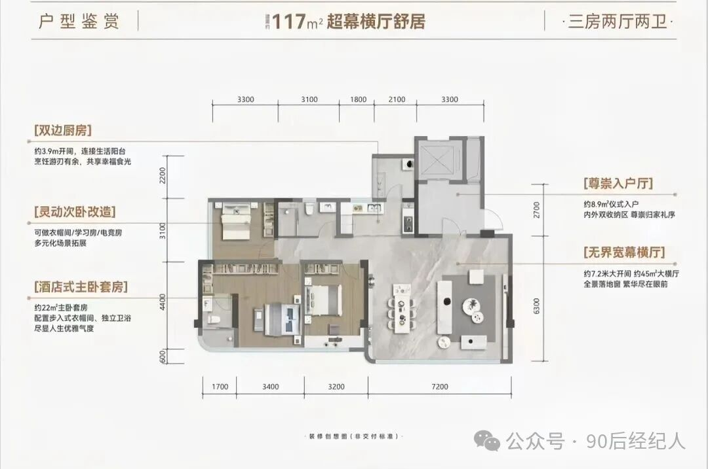
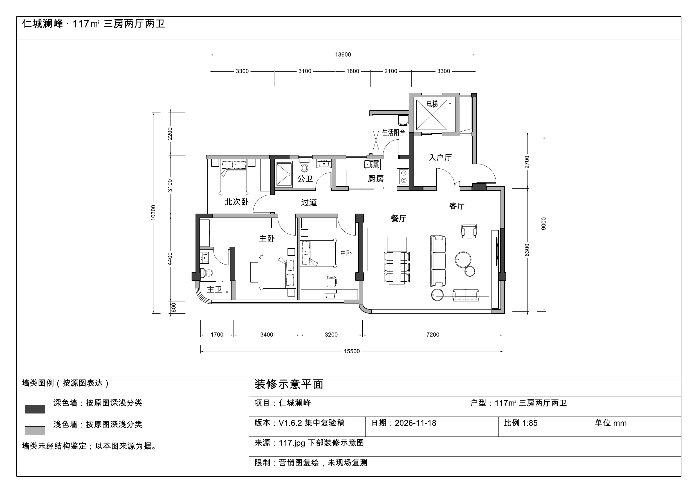

# plan-to-cad

A Codex skill that turns residential floor-plan images into editable, layered DWG drawings. It works with sales brochures and scans, with or without printed dimensions. · [简体中文](README.md)

**Version V1.6.5** · [Install in Codex](#install-in-codex) · [Download the release](https://github.com/yangplato/plan-to-cad/releases/tag/v1.6.5) · [Quick start](#quick-start)

## From image to CAD

| Original sales plan | CAD drawing on an A3 sheet |
| --- | --- |
| <a href="assets/readme/rencheng-117-lower.jpg"></a> | <a href="assets/readme/rencheng-117-cad-sheet.png"></a> |

[See both examples in the Chinese README](README.md#案例对照)

## What you get

- **An editable DWG in millimetres.** Walls, doors, windows, furniture and room labels are in model space on separate layers. Doors and furniture use blocks from the included library.
- **The source image as an overlay.** Toggle the `A-XREF` layer to compare it with the drawing. The A3 layout holds the frame, title block and legend. A PDF is included by default for preview.
- **Checks before delivery.** The workflow reopens the DWG in AutoCAD. It checks room connections, openings, the wall segments next to door openings, and clearances. It records which dimensions came from the image and which were inferred.
- **Feedback for future jobs.** The workflow saves your drawing corrections in a shared feedback log and consults it before starting the next floor plan.

## Install in Codex

Open a new chat in the Codex desktop app and paste this message.

```text
Install plan-to-cad V1.6.5 for me using this release:
https://github.com/yangplato/plan-to-cad/releases/tag/v1.6.5

Download plan-to-cad-v1.6.5.zip and verify it against the SHA-256 file on the same release page. Put the entire plan-to-cad folder in my Codex personal skills directory. If an older copy is installed, back it up and update it in place. Show me how to verify that Codex recognizes $plan-to-cad.
```

If you already have the ZIP, attach it in Codex and ask Codex to install the skill from it. The DWG workflow was tested on macOS with Python 3.12 and a licensed copy of AutoCAD 2025 for Mac.

## Quick start

Attach a floor-plan image in Codex, give it a destination folder, and send this request.

> Use `$plan-to-cad` to turn this floor plan into a layered DWG. Use the included blocks for doors and furniture. Review each room, then open the DWG with the source image overlay enabled.

If the image has no printed dimensions, include a known measurement if you have one. With no reliable scale, the workflow can provisionally scale the plan from a clearly identifiable shear wall using an assumed thickness of 200 mm. The report marks that scale as an estimate.

[完整中文说明 / Full Chinese guide](README.md) · [Third-party notices](THIRD_PARTY_NOTICES.md)
