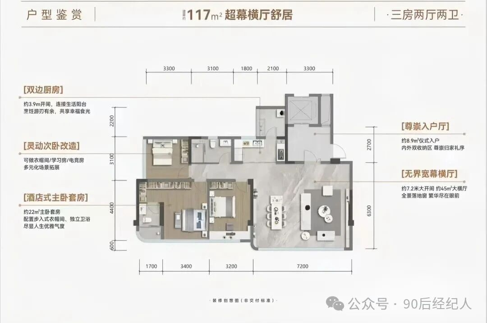
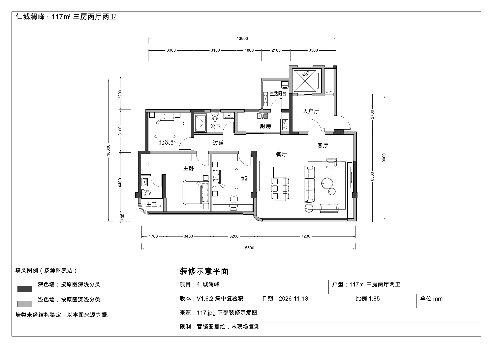
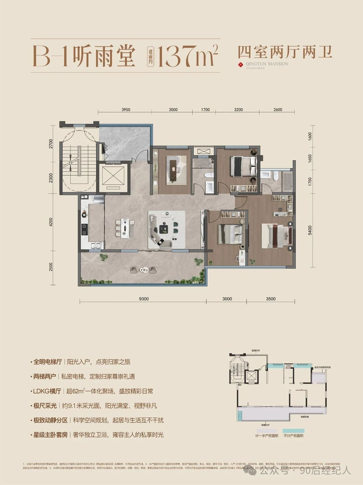
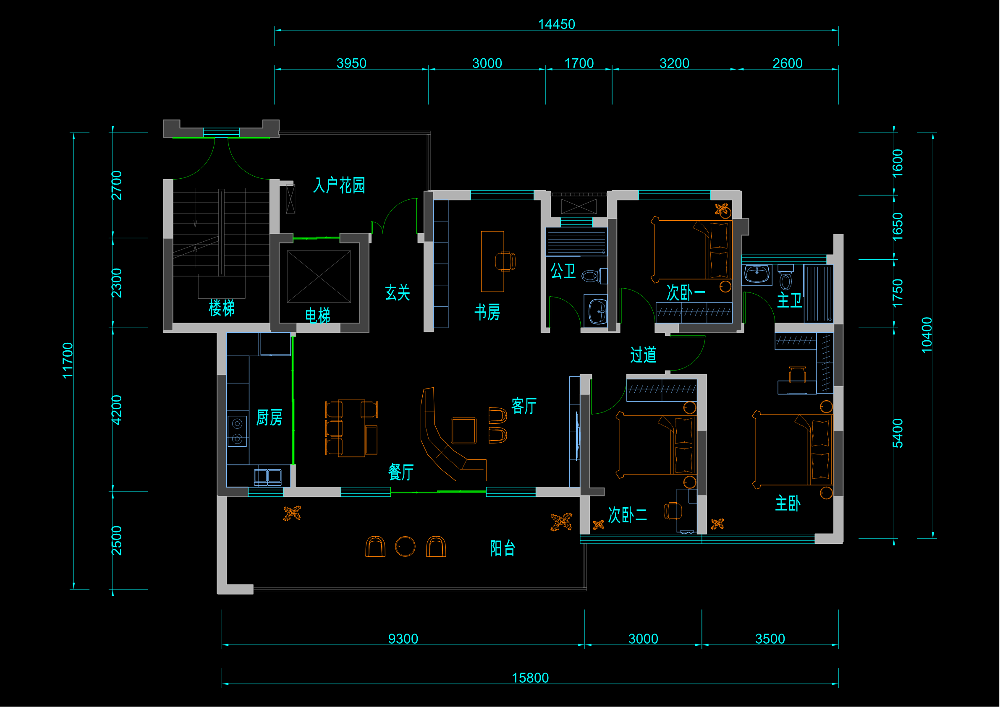

# plan-to-cad · 平面一键 CAD

把住宅户型图重建为可编辑的分层 DWG，原图有无尺寸标注都可以用。 · [English](README.en.md)

**当前版本 V1.6.5** · [安装到 Codex](#安装到-codex) · [下载发布包](https://github.com/yangplato/plan-to-cad/releases/tag/v1.6.5) · [如何使用](#如何使用)

## 案例对照

### 仁城澜峰 117㎡

| 营销户型图 | CAD 线稿与 A3 图框 |
| --- | --- |
| <a href="assets/readme/rencheng-117-lower.jpg"></a> | <a href="assets/readme/rencheng-117-cad-sheet.png"></a> |

<details>
<summary>查看青云书院 137㎡ · CAD 模型空间</summary>

| 营销户型图 | CAD 模型空间（无图框） |
| --- | --- |
| <a href="assets/readme/qingyun-137-source.jpg"></a> | <a href="assets/readme/qingyun-137-model.png"></a> |

</details>

## 安装到 Codex

在 Codex 桌面端新建一个会话，复制下面整段发给它。

```text
请帮我安装「平面一键 CAD」V1.6.5。
发布页：https://github.com/yangplato/plan-to-cad/releases/tag/v1.6.5
请下载发布页里的 plan-to-cad-v1.6.5.zip，用同页的 SHA-256 校验文件核对后，将完整的 plan-to-cad 文件夹放进当前 Codex 的个人技能目录。如果已经装过，请备份旧版，再更新原来的安装位置。安装后告诉我怎么确认 Codex 能识别 $plan-to-cad。
```

如果你已经拿到 ZIP，直接拖进 Codex，说「请用这个 ZIP 帮我安装平面一键 CAD」。安装后，在输入框键入 `$plan-to-cad`，看它是否出现在技能列表中。如果没有出现，重启 Codex 再看一次。

## 如何使用

1. 将原图拖进 Codex。优先使用能看清尺寸数字和尺寸界线的图片。告诉 Codex 成果要存在哪个项目目录。
2. 在对话中输入下面的指令。

   > 用 $plan-to-cad 把这张户型图画成分层 CAD。家具和门从内置的室内平面图块库选。画完逐间审查，把原图叠在 CAD 里打开。

3. 原图无明标时，有已知长度可随图提供。否则按图中可辨剪力墙的 200 mm 假定厚度定标，报告注明比例暂定。

## 打开和使用成果

- 在 DWG 中打开或关闭 `A-XREF`，即可切换叠图和纯线稿。把图纸发给别人时，发送整个结果目录，保留 DWG 旁的「参照」文件夹及其中的原图。
- 墙体、门、窗、活动家具、固定家具及设备各有对应图层。可以单独隐藏家具查看结构，也可以选中图块移动。
- 打开 A3 线稿 PDF 检查打印效果。审查记录列出原图明标、推定尺寸和本次修正。
- 模型空间直接显示房名。图框、图签和图例保存在 `Plan-A3` 布局。你可以在布局里修改图框，也可以随原图提供自己的 CAD 图框模板，告诉 Codex 这次用哪一套。

## 越用越懂你的习惯

**交付反馈会自动进入全局错题集，供后续所有户型参考。** 你看完交付图纸后，直接在对话中指出哪里需要改。技能会在当轮保存你的原话和对应图纸，并写明这条意见适用于什么情况、下次要核对什么。

**下一套户型在读图、定标之前自动读取错题集。** 绘图者按本案原图选用相关条目。常规制图入口还会在 AutoCAD 预检前，将当时生效的条目保存为 `开工错题清单.md`。例如，你指出鞋柜门打开会碰餐椅，以后遇到鞋柜紧邻餐区的户型，绘图者就会核对柜门开启范围和拉椅空间。

每案另留一份短复盘，保存改前改后实量、证据、复验结果、未查项、终稿哈希和实际用时。无新增经验时引用已有记录。涉及验收标准的调整，按用户明确决定执行。[错题集与作业复盘说明](references/experience.md)

## 使用内置图库

[室内平面图块库（DXF）](assets/interior-plan-blocks.dxf) 随技能提供，包含家具、柜体、厨卫设备、门和楼梯等 97 个毫米制图块。家具全部选参考库块，按数量、朝向、占地与通行对位。通常只需提供户型原图。想指定某个图块时，用 CAD 打开图库，选好后把编号告诉 Codex，例如“北卧用 BD04 双枕双人床”。

有项目专用图库时，可随图提供并指定优先使用。[图库选用方法](references/plan-families.md)

## 实测说明

1. Skill的目标并非100%准确,而是让人手工画图的时间减少99%; 取得成果后,通常你只需要拉伸多段线顶点、整理矩形便可获得相对满意的成果
2. 实例测试基于codex桌面端,在 6.2 sol high/ 6.2 astra high/ 6 astra high上都有稳定的表现,额度消耗通常不超过pro 5x周额度的1%(以6 astra high测试)

## 运行环境与自测

后台生成和复开 DWG 已在 macOS、Python 3.12 和已授权的 AutoCAD 2025 for Mac 上验证。第一次使用时，可以直接告诉 Codex「请帮我检查 AutoCAD 能否在本机保存并复开 DWG，再按技能的 `requirements.txt` 配置 Python 环境」。如果想手动跑一份合成示例，在技能目录执行以下命令。

```sh
python3 -m venv .venv
. .venv/bin/activate
python -m pip install -r requirements.txt
python examples/smoke_job.py work/demo-input
python scripts/run_first_plan.py work/demo-input/job.json work/demo-output
```

[作业参数与图像配准](references/draft-from-schedule.md) · [绘图、叠图与复量检查表](references/stage-checks.md) · [组件与素材说明](THIRD_PARTY_NOTICES.md)

<details>
<summary>觉得有用的话，可以请我喝杯咖啡</summary>


</details>
